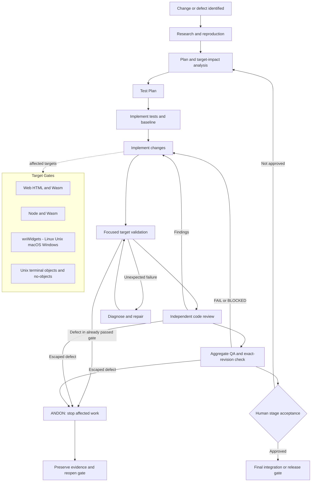

# Quality Assurance Process

## Purpose

This document defines the quality process for UCBLogo. It applies to source code, tests, build scripts, documentation, Web Edition assets, native targets, CI, releases, and process changes.

Quality means correct behavior, reproducible builds, trustworthy evidence, clear scope, and no hidden regressions. Quality is a shared responsibility, not a final test phase.

## Principles

- Preserve correct behavior unless a documented requirement or approval changes it.
- Prefer the narrowest check that discriminates the changed behavior.
- Rebuild when source or embedded assets change; never validate stale artifacts.
- Test observable behavior at the lowest effective layer.
- Record exact revisions, configurations, commands, results, and coverage limits.
- Treat skipped, filtered, unavailable, and human-only checks as uncovered, not passing.
- Stop work when a defect affects a passed gate or reveals a systemic issue.
- Keep changes small, reviewable, reversible, and tied to acceptance criteria.
- Avoid retries or timing changes as substitutes for deterministic synchronization.
- Do not clear user storage or interfere with unsaved work for a test run.

## Scope

### Source and runtime targets

Select validation according to the affected target:

- Logo language, primitives, files, memory, and garbage collection: Logo regressions and the native or Node harnesses.
- Web runtime bridge, DOM, events, storage, UI, SVG, and reentrancy: fresh Web artifacts plus the shared TestCafe suite.
- Node/WebAssembly behavior without browser APIs: the Node Logo and Node/Wasm suites.
- wxWidgets, Unix terminal, and PTY behavior: the native CI jobs and available local smoke checks.
- Build recipes, service workers, packaging, and deployment: source/build validation plus a fresh served artifact.

Changes affecting multiple targets require coverage for each materially affected target. An isolated passing result does not prove cross-target correctness.

### Test layers

Use tests in this preference order:

1. A narrow unit or source check for deterministic logic.
2. A Logo regression for interpreter-language behavior.
3. A Node/Wasm check for runtime behavior without browser dependencies.
4. A browser acceptance test for DOM, events, persistence, Web APIs, or visual behavior.
5. A native target or device check for platform-specific behavior.
6. A manual human checkpoint for native keyboard, touch, rotation, hardware, or physical device behavior.

Do not run browser tests solely to repeat lower-layer language logic. Conversely, Node success does not establish browser behavior.

## Development Workflow

Every stage produces a deliverable, independent evidence or review as applicable, and a human checkpoint. Material scope, acceptance, or target changes reopen the earliest affected stage.

| Stage | Required deliverable | Stage exit |
| --- | --- | --- |
| Research | Reproduction or goal, local evidence, affected targets, constraints, uncertainties, and risks | Independent QA verdict and explicit human approval of that revision |
| Plan | Bounded tasks, dependencies, file ownership, implementation map, acceptance criteria, rollback, and visual applicability | Independent QA verdict plus the required specialized or not-applicable decisions and explicit human approval |
| Test Plan | Acceptance criteria, mapped cases, setup/teardown, fixtures, commands, regression scope, and visual scenarios | Independent QA verdict and explicit human approval of that revision |
| Implement Tests | Reviewable tests and baseline execution, including an intended-failure demonstration for behavior changes | Independent QA verdict and explicit human approval of that revision |
| Implement Changes | Small scoped changes, focused validation, commit evidence, and aggregate regression evidence | Independent QA verdict and explicit human acceptance of the exact revision before Code Review |
| Code Review | Independent severity-ordered findings, repairs, re-review, residual risks, and final aggregate QA evidence | Independent QA verdict and explicit human sign-off |

At every stage, present the stage summary, evidence, QA verdict, risks, and a specific approval question. Silence, the initial request, or an earlier stage approval does not approve a later stage or revision.

### Specialized review applicability

During Research and Plan, classify every change for the following gates:

- **Logo language behavior:** Apply the Logo Language CTO Reviewer gate for intentional changes to parsing, syntax, primitive names or arity, defaults, evaluation semantics, language-level errors, core library behavior, or dialect/compatibility guarantees. Implementation changes that preserve observable language behavior do not trigger this gate. If applicability is uncertain, report it for routing; do not silently waive review. A CTO PASS supplements, and never replaces, Development Reviewer, Development QA, language tests, or human approval.
- **Visual/UI:** Apply the Development Design Reviewer gate for layout, typography, color, imagery, animation, responsive behavior, visible interaction states, or accessibility impact. Before Plan approval, independently review proposed screens/mockups and affected states. After implementation, independently review actual rendered output and interactions at agreed desktop/mobile viewports and states. Source code alone is not rendered evidence.
- **Accessibility:** Treat keyboard operation, focus, semantic state, screen-reader behavior, contrast, and touch target changes as specialized UI/visual work when applicable. QA shall verify a proposed gate determination or a rendered not-applicable determination.

Specialized review PASS, FAIL, or BLOCKED results do not replace Development Reviewer coverage or aggregate Development QA. Material visual or semantic repairs require fresh specialist review and affected QA.

### 1. Define the change

Before implementation:

- state the defect or user-visible requirement;
- identify affected targets and ownership;
- define observable acceptance criteria;
- identify regressions and unresolved risks;
- determine whether visual or accessibility review is required.

Material ambiguity that prevents a bounded implementation shall stop the affected line and reopen the earliest affected planning gate.

### 2. Reproduce and plan tests

When a behavior is absent or broken:

- establish the reproduction with exact inputs and target revision;
- write or define a discriminating test that fails for the intended reason;
- separate setup failures and syntax defects from product failures;
- identify fixture data, setup, teardown, environment, and cleanup.

Behavior-preserving work requires a baseline and an explanation of the relevant regression protection.

### 3. Implement tests

Add regressions to the existing suite and shared harness. Prefer deterministic observable assertions over implementation details, arbitrary delays, and incidental formatting.

A test is implementation-ready only when it:

- is compatible with existing fixtures and capability filtering;
- waits for real readiness or observable state;
- restores settings or runtime state it modifies;
- preserves unrelated user work; and
- reports individual failures rather than relying on completion text alone.

### 4. Implement the change

Keep implementation substeps small and independently reviewable. Each substep shall run the agreed focused check, inspect the complete diff, and preserve unrelated changes.

Build and test results shall use exact source and artifacts. Reconfigure or clean targets before switching profiles; do not use stale objects or generated output as evidence.

### 5. Review and integrate

Inspect the complete stage diff and exact final revision. Code and test work shall have independent review where required by the repository workflow. Documentation, configuration, and process substeps follow the relevant QA and commit checks.

Material changes invalidate affected review and QA verdicts. Repairs require a fresh focused check and any affected independent review.

### 6. Final acceptance

Before reporting completion:

- review the exact commit range or revision;
- verify that requested checks passed against fresh artifacts;
- confirm coverage and record skips or unavailable platforms;
- ensure test reports and residual risks correspond to the tested revision;
- obtain the human approval required for the stage or publication.

## Test and Build Commands

Use the repository package scripts and CI inventory as the source of truth. Common Web Edition gates are:

| Goal | Command | Result boundary |
| --- | --- | --- |
| Build and run the complete Web suite | `npm test` | Build, source checks, and functional browser acceptance |
| Source checks only | `npm run test:source` | Existing source and Node-side checks; no rebuild |
| Full browser suite against existing artifacts | `npm run test:browser:built` | All discovered functional fixtures; may include capability filtering |
| Browser suite with a fresh build | `npm run test:browser` | Fresh Web build followed by functional browser acceptance |
| Node/Wasm Logo grading | `npm run test:logo:node` | Existing Node/Wasm build; inspect individual results |
| Focused browser test | `node tests/acceptance/run-testcafe.js --test 'exact test name'` | One exact test name |
| TestCafe pattern | `node tests/acceptance/run-testcafe.js --test-grep 'regex'` | Matching tests |
| Lighthouse | `npm run test:lighthouse` | Separate audits, not functional or language coverage |
| Whitespace verification | `node scripts/format-whitespace.js --check --changed` | Markdown and prose formatting |

Run focused checks during iteration. Broaden browser, native, and device coverage before integration, publication, or reporting release readiness. Do not run the entire platform matrix after every edit unless required by the change or an approved gate.

## Browser and Device Coverage

The Web Edition shall be validated through the shared TestCafe platform matrix. Broader validation runs in this order:

| Priority | Platform | Validation type | Evidence boundary |
| --- | --- | --- | --- |
| 1 | Desktop Chrome / Chromium | Headless and affected headed runs | Primary desktop regression platform; record browser and engine versions |
| 2 | Mobile Chrome / Chrome emulation | Emulated phone viewport and touch behavior | Responsive evidence, but not a physical phone pass |
| 3 | Firefox | Desktop and relevant mobile-emulated coverage | Distinguishes Chromium-family behavior and Web API differences |
| 4 | Real iPadOS Safari | Human-in-the-loop remote Safari and PWA session | Native keyboard, physical touch, rotation, storage, lifecycle, and offline evidence |
| 5 | Desktop Safari | macOS CI or approved hosted macOS browser | Supported but unavailable locally; do not infer it from iPad Safari or WebKit automation |

Additional mobile Firefox coverage applies when relevant or explicitly requested. Broaden before pushing, opening a PR, or reporting final readiness; checkpoint commits do not require the complete matrix unless a platform-specific failure or approved risk trigger requires it.

### Web platform evidence rules

- Use Chrome for the default focused desktop iteration. Use Chrome device emulation for mobile-first layout or touch iteration without a physical device.
- Firefox follows mobile Chrome/emulation in the default broader-validation order. Prioritize it earlier when diagnosing a Firefox-specific failure.
- Desktop Safari requires actual Safari on macOS or an approved macOS CI/hosted Safari service. Automated WebKit is not a desktop Safari pass.
- iPad Safari requires a coordinated human session on the maintainer's iPad. Synthetic Visual Viewport changes, dispatched orientation events, proxy clicks, and in-page `.click()` calls are not native keyboard, physical touch, or physical rotation evidence.
- TestCafe capability filtering is an environment limit, not a passing result for excluded cases. Record exact capability and resize exclusions.
- iPad Safari does not establish iPhone or desktop Safari coverage. Mobile Chrome emulation does not establish a physical Android or iPhone pass.
- Report engine, browser, OS/device, profile, emulation versus real-device status, viewport, build, and exact test selection.

### Real iPad session

A real iPad session shall use a dedicated fresh test runtime, preserve unsaved work, verify the served build, and record:

- device and browser versions;
- Safari tab or installed-PWA mode;
- commit, build configuration, and served artifact;
- runner settings and exact filters;
- automated results and capability exclusions;
- native keyboard and rotation observations;
- touch, background/resume, storage, reload, and offline behavior;
- unavailable or pending checks.

Desktop Safari is not claimed locally without actual evidence. Human iPad signoff is pending rather than inferred from automated emulation or remote automation.

## Artifact Freshness

Before trusting a result:

- identify the target and profile;
- confirm the source revision and dirty state;
- rebuild after changes to embedded files, C sources, shell markup, runtime JavaScript, Logo startup files, or generated assets;
- verify the HTML, loader, Wasm, packaged files, and server root belong to the intended build;
- verify a reused browser page is on the intended origin and has bypassed stale HTTP or service-worker state;
- verify the server is owned or reused by the operator and will be cleaned up correctly.

A build on disk does not update an already-running runtime. When behavior contradicts source or a previous result, diagnose freshness first. Do not clear all site data by default.

## Stop-the-Line and Escalation

A normal failed test or rejected implementation is not automatically an Andon. Continue bounded diagnosis within the approved scope.

Stop and report an Andon when:

- a defect is found in an artifact, commit, decision, or approval that already passed a gate;
- a defect reveals a likely systemic or cross-target issue;
- a failed gate blocks advancement;
- a required review or evidence is unavailable;
- a requirement becomes too ambiguous to proceed safely; or
- three consecutive focused fix-and-check attempts fail on the same issue.

On an Andon:

1. stop the affected work immediately;
2. preserve exact revision and evidence;
3. notify the human and affected owners;
4. identify the affected scope and plausible consequences;
5. reopen the earliest invalidated gate;
6. do not resume until the human or governing process authorizes a resolution.

A current-gate FAIL or BLOCKED permits bounded correction; it is not automatically an escaped-defect Andon unless work already passed a gate.

## Evidence and Reporting

Every quality report shall state:

- purpose and scope;
- exact revision, commit range, branch, and dirty state;
- target, build profile, runtime, browser, and device where applicable;
- commands or methods;
- actual pass, fail, blocked, skipped, and unavailable results;
- individual test results rather than only overall exit status;
- residual risks and coverage gaps;
- temporary processes or servers retained after the task.

For formal workflow checks, append structured results under `docs/workflow-runs/<task-id>.md` in `## QA and Check Results`. For checks with no formal workflow record, append a canonical entry to `docs/qa-result-log.md`. Both logs shall preserve prior failures and use `Supersedes` for later corrections. Never rewrite history to conceal a missed gate or failed result.

A result shall use only:

- `PASS`: evidence satisfies the exact acceptance criteria;
- `FAIL`: evidence demonstrates a missed criterion or defect;
- `BLOCKED`: required evidence, review, toolchain, network, hardware, or scope is unavailable;
- `N/A`: the result is explicitly reasoned and tied to a non-applicable criterion.

Missing evidence is `BLOCKED`, never an assumed pass.

## Git and Commit Discipline

- Make frequent small commits after cleared semantic blocks. Commit intermediate local checkpoints early even if broader work remains.
- Stage only task-owned files and inspect the complete staged diff, staged file list, and whitespace before committing.
- Run focused validation and record its actual result against the staged or exact target revision before committing.
- For code/test commits, obtain required independent Development Reviewer coverage of the exact staged content. QA is not a routine pre-commit gate, but aggregate QA applies to the final stage revision.
- For non-code commits, stage only QA-cleared content and have QA verify that the staged diff matches the cleared substep and evidence. Repeat QA if staging changes cleared content.
- Add a fresh commit-native accounting checkpoint immediately before every local commit, after staged-diff inspection. Record the exact staged paths or revision and the resulting local commit hash. Do not invent unavailable billing or usage data.
- Keep intermediate commits on a private or unshared branch; do not imply unpushed work is integrated.
- Every push requires fresh explicit human approval for the exact remote, destination branch, and commit range or commits. Do not push, force-push, or rewrite pushed history without that approval.
- Stop and disclose a process failure if required review, QA evidence, staged-diff review, accounting evidence, or push approval is missing for a commit or publication.

## QA Result Logging

- Record formal workflow checks under `docs/workflow-runs/<task-id>.md` in `## QA and Check Results`.
- Record checks with no owning formal workflow under `docs/qa-result-log.md` using one canonical H3 entry per independent check or disposition.
- Include UTC timestamp, task/session, scope, check type, owner/checker, result, exact revision or artifact, commands/method, evidence, findings/corrections, residual risks/limits, and `Supersedes`.
- Use `PASS`, `FAIL`, `BLOCKED`, or explicitly reasoned `N/A`. Missing evidence or unavailable required review is `BLOCKED`, never inferred `PASS`.
- Corrections append a new entry and reference prior entries through `Supersedes`; never rewrite or erase earlier evidence.
